# Краем глаза / Corner of the Eye

Хоррор-мод для **Minecraft 1.20.1 (Forge 47.x)**, для одиночной игры и кооператива.

В мире живёт **Тот, что в углу**. Он виден только краем глаза: стоит посмотреть прямо, и его нет. Он гасит свет, на который ты не смотришь, проходит сквозь стены и с каждой ночью подбирается ближе. Его нужно изгнать до седьмой ночи, потом будет намного сложнее.


## Как это работает

**Его видно только краем глаза.** Каждый клиент считает, где на экране находится монстр, и плавно растворяет его ближе к центру. В коопе один игрок может его видеть, а другой нет. Если долго смотреть прямо на него, он перескакивает в другое место, чуть ближе.

**Свет — единственная защита.** В освещённые блоки он не заходит и не может тронуть игрока, который стоит на свету. Поэтому он гасит свет, причём только тот, на который сейчас никто не смотрит. Подробнее в разделе «Свет и факелы».

**Стены не спасают.** Он найдёт дверь, окно или лаз, а если обходить слишком долго, прогрызёт стену, блок за блоком (см. «Как он ищет путь» и «Сквозь стены»).

**Убивает не сразу.** На второй стадии касание ранит, но никогда не убивает. На третьей касание отнимает половину здоровья, после чего монстр отходит и снова наблюдает. Если остаться в темноте, второе касание убьёт.

**Монстр один на весь мир.** Каждую ночь он выбирает одну жертву, чаще того, кто один и в темноте. Разделяться опасно.

**Страх без шкалы.** На экране нет никаких полосок. О том, насколько близко опасность, говорят только чувства:
- **Сердцебиение.** Чем он ближе, тем чаще и громче стучит сердце. На поздних стадиях оно ускоряется уже просто в темноте.
- **Удар «краем глаза».** Когда он появляется на краю экрана, звучит резкий диссонансный аккорд. Даже если ты его не заметил, уши заметили.
- **Твоё дыхание.** При сильном страхе слышно собственное частое дыхание, а когда он совсем рядом, звенит в ушах.
- **Мир затихает.** Звуки мира (шаги, блоки, погода, животные) становятся тише и чуть ниже, будто время замедлилось. Громким остаётся только он и твоё сердце. Под всем этим нарастает низкий гул.
- **Зрение сужается.** Края экрана темнеют и пульсируют в такт сердцу, угол обзора слегка сужается, а значит, места, чтобы заметить его краем глаза, становится меньше. При сильном страхе дрожит камера.
- **Резкие всплески.** Когда рядом гаснет свет, сердце подпрыгивает.

**С каждым днём он страшнее.** Он подрастает каждый день. На второй стадии по коже ползут чёрные вены, у рта засохшая кровь. На третьей кожа трескается, проступают рёбра, появляются лишние глаза, и все горят красным, когти длиннее, челюсть отвисает сильнее, он чаще дёргается, голос ниже, а скример становится другим.


### Как он ищет путь

Он не прёт напролом. Он думает, как тот, у кого вся ночь впереди: пока ты перебегаешь с места на место, он снова и снова прокладывает путь по блокам и выбирает самый короткий по времени:
- **дверь** стоит ему пары шагов. К ней он подходит уже на ногах, кладёт на неё ладонь, замирает, будто прислушивается, и медленно открывает с низким долгим скрипом. Так же открывает люки и калитки. Железные двери и люки рукой не открыть, поэтому рядом с ними он ломает стену. Иногда, пройдя пару шагов, тихо закрывает дверь за собой;
- **окно, пролом, щель в блок высотой, пещера** идут в ход раньше стен. По стенам и потолку он лезет, как паук, в щель протискивается ползком, с уступов спрыгивает;
- **стену** он прогрызает, только если обходить намного дольше: каждый блок стоит ему как долгий путь, а твёрдый блок ещё дороже. Дверь в десяти шагах всегда лучше стены, а если дверь на другом конце большого дома, он прогрызёт стену там, где стоит;
- **свет** для него стена, которую не пробить: через освещённые клетки он не ходит. Если у двери горят факелы, он прогрызёт тёмную стену сбоку;
- **плиты, ковры, снег** он переступает, в лаву не лезет. **В воде** плавает: может пройти по дну и вынырнуть прямо под твоей лодкой;
- **на высоте не спрячешься.** На столб, крышу, дерево или скалу он лезет по стенам, как паук: головой вверх, прижавшись к блокам, а вниз спускается головой вперёд. По воздуху не летает, ему нужно, за что держаться;
- **если до тебя не добраться** (платформа в небе, к которой ничего не ведёт), он отходит туда, где ты его видишь, встаёт внизу и смотрит вверх, на тебя, а тем временем гасит твой свет. Стоит отвернуться, и через несколько секунд он уже у тебя за спиной, в темноте. Пару секунд он просто стоит и дышит, давая обернуться. На освещённое место он не появится;
- **в подвале или бункере** он проходит по крыше точно над тобой, прокапывает потолок и свешивается вниз головой;
- **копает с длины руки.** Он останавливается так, чтобы когти доставали до стены и не дальше. Если подошёл слишком близко (из-за угла или по стене), сначала отползает назад, не сводя с неё глаз. Поэтому изнутри сначала слышен скрежет и видны трещины, а когти появляются, только когда блок поддаётся;
- **если пути нет совсем** (ты слишком далеко или в бункере, к которому не подойти), он подходит как можно ближе и оттуда идёт прямо на тебя, вгрызаясь во всё, что на пути. Наугад, например под твой пол, он не роет. Неразрушимые блоки (бедрок) проходит насквозь, по-старому.

Если копание выключено (`digThroughWalls` или правило `mobGriefing`), он всё равно ищет дверь и обход, а когда их нет, проходит сквозь стену, как раньше.

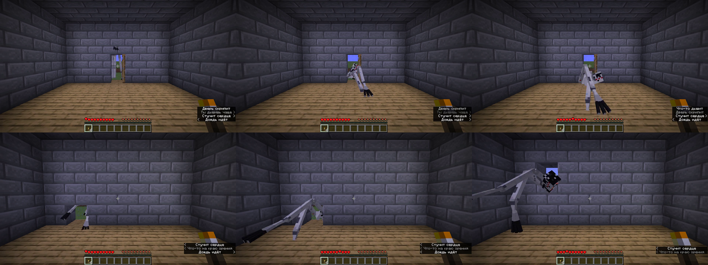

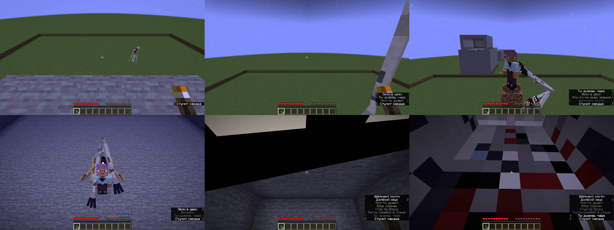

### Сквозь стены

Когда оно идёт за тобой, оно не проходит сквозь блоки, а прогрызает их по одному:
- **перед первым блоком** замирает, прижавшись к нему лицом и ладонями, медленно растопыривает пальцы и прислушивается. Потом начинает;
- **вперёд:** когти бьют в блок и скребут по нему вниз, одна рука, потом другая, голова бьётся о камень и кусает его. С той стороны слышно скрежет, по блоку ползут трещины, а первыми наружу пробиваются когти;
- **вверх:** вцепляется в блок над руками и рвёт его, задрав голову;
- **вниз:** выгребает блок под собой, как собака;
- **в туннель высотой в блок** помещается целиком: ползёт плашмя на животе, ноги волочатся сзади, руки впереди цепляются за пол и подтягивают тело. В туннеле, уходящем вверх или вниз, лежит вдоль склона;
- **пробившись к тебе**, если ты видишь дыру, на секунду замирает в ней и смотрит, одна рука тянется внутрь;
- **выбравшись туда, где хватает места** в высоту и ширину, останавливается и медленно распрямляется во весь рост, а дальше идёт выпрямившись, не торопясь. Если снова стена, опять опускается и грызёт.

Чем твёрже блок, тем дольше: на первый блок у него уходит пара секунд, на обсидиан около десяти. Уже начав копать, он не останавливается, и каждый следующий блок поддаётся быстрее. Неразрушимые блоки (бедрок) он, как раньше, проходит насквозь. Сломанные им блоки ничего не оставляют (можно включить дроп), сундуки при этом высыпают содержимое.

Копание отключается в конфиге (`digThroughWalls`), тогда он, как раньше, проходит сквозь стены. Учитывается и игровое правило `mobGriefing`.

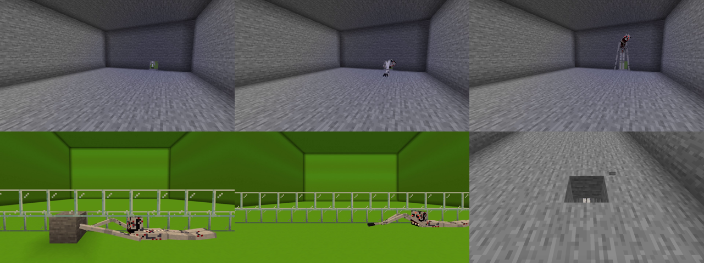

### Под размер комнаты

Оно подстраивается под потолок над собой:
- **под потолком в 2 блока** (низкий дом, лаз, нора) ходит только на четвереньках, а в совсем узкой щели распластывается, разводя локти и колени в стороны, как паук;
- **в комнате в 3 блока** не помещается во весь рост: сгибается, колени согнуты, голова втянута, когти волочатся по полу;
- **где просторно** распрямляется во весь свой рост.

Поэтому в моменте «Оно в доме» в низком доме оно так и ползёт на тебя, в обычном идёт сгорбившись, а в высоком встаёт во весь рост.

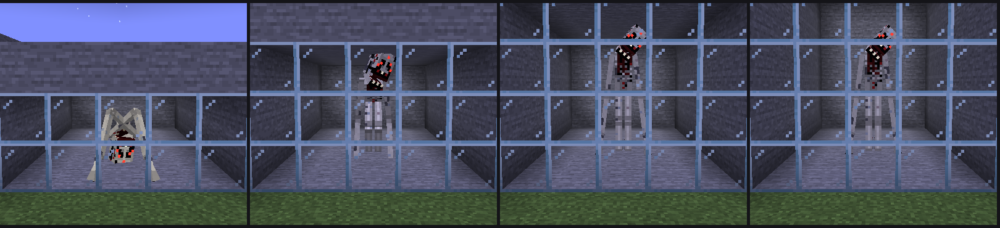

## Свет и факелы

- **Пока он охотится или устраивает момент, гаснет любой свет:** факелы, фонари, костры, свечи, лампы, светокамень, морские фонари, грибосвет, свет из других модов. Погашенные блоки выглядят мёртвыми и не дают ни капли света.
- **Печи** (обычная, коптильня, плавильная) гаснут и замирают: огонь пропадает вместе с топливом, которое горело, переплавка стоит.
- **Само ничего не загорается.** Даже после того как он ушёл, всё погашенное остаётся погасшим.
- **Разжечь можно огнивом или огненным зарядом:** правый клик по погасшему блоку. Печь после этого снова берёт топливо и продолжает работу.
- **Пока он рядом, огниво не помогает:** «Не загорается. Пока оно здесь — нет.» Спасает только свежий свет, например новый факел из инвентаря.
- **Важна яркость.** Под таймером видно «СВЕТ 6 / 9»: нужно стоять достаточно близко к источнику. Одной печки в углу комнаты мало.
- **Погашенный им блок мёртв:** если его сломать, он рассыпается без дропа. Содержимое печки при этом выпадает. Так что «сломать и поставить заново» не сработает.
- **Факелы сгорают** в «потухший факел». Если сломать и поставить обратно, он так и останется потухшим, разжигается только огнивом.
- **Факелы теперь дорогие:** уголь + нить + палка (сверху вниз) = 1 факел. Факел душ делается так же, плюс песок или почва душ.


### Стадии

Счёт идёт по времени, проведённому в мире (20 минут = 1 день). Сон и `/time set` его не сбивают.

| День | Стадия | Что происходит |
|---|---|---|
| 0–1 | Тишина | Далёкие звуки; иногда гаснет свет на краю базы |
| 2–3 | Наблюдение | Ночью и в тёмных пещерах стоит вдали и смотрит. Шаги за спиной, стук в дверь, копание в стенах. В кармане появляются чужие записки |
| 4–5 | Приближение | Подходит ближе, кружит по краю зрения, гасит свет вокруг. Шёпот, фейковый чат (в коопе от имени друга), таблички, прерывает сон. Может ранить |
| 6+ | Охота | Каждую ночь, сквозь стены, касание может убить. Густой туман |

### Затишье и нарастание

Он не пугает без передышки. У каждого игрока своя волна, как в хорошем хорроре:
1. **Тишина.** Несколько минут не происходит ничего. Совсем ничего. На первой стадии это 10–15 минут, на третьей полторы-две с половиной.
2. **Нарастание.** Сначала что-то далёкое: звук где-то в стороне, погасший факел на краю базы. Потом ближе: шаги за спиной, стук в дверь. Под конец совсем рядом: шёпот, скрежет в стене у тебя под боком.
3. **Ожидание.** Он готов и ждёт, когда можно будет показаться.
4. **Встреча.** Он приходит: наблюдает, охотится или устраивает момент. Когда уходит, снова тишина.

Ночью, в темноте и в кровавую луну волна поднимается быстрее. Чем сильнее тебя только что напугали, тем дольше потом затишье: страшно, когда есть с чем сравнить.


### Ночи и кровавая луна

С наступлением каждой ночи вдалеке бьёт колокол, а по экрану медленно проступает «НОЧЬ 3» с короткой строкой под ней: «Тебя заметили.», «Оно знает, где ты спишь.». С седьмой ночи надпись красная. Счёт идёт по дням мира, поэтому сон не повторяет карточку.

На стадиях 2 и 3 некоторые ночи бывают **кровавыми** (15% и 35%). Небо и туман краснеют, вместо луны всходит распухшая красная. В такую ночь он приходит вдвое чаще, моменты случаются вдвое чаще, и двигается он быстрее. Ночь перед последней поимкой кровавая всегда.

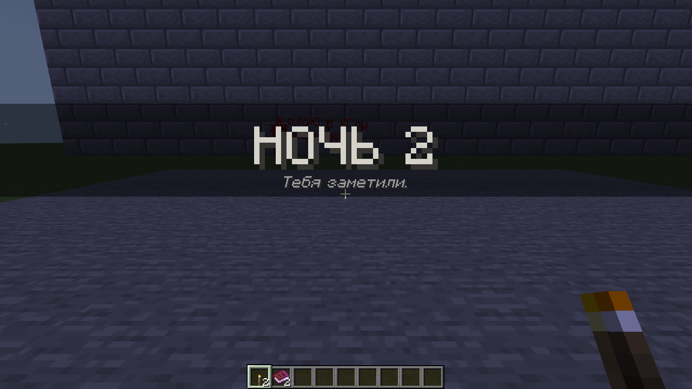

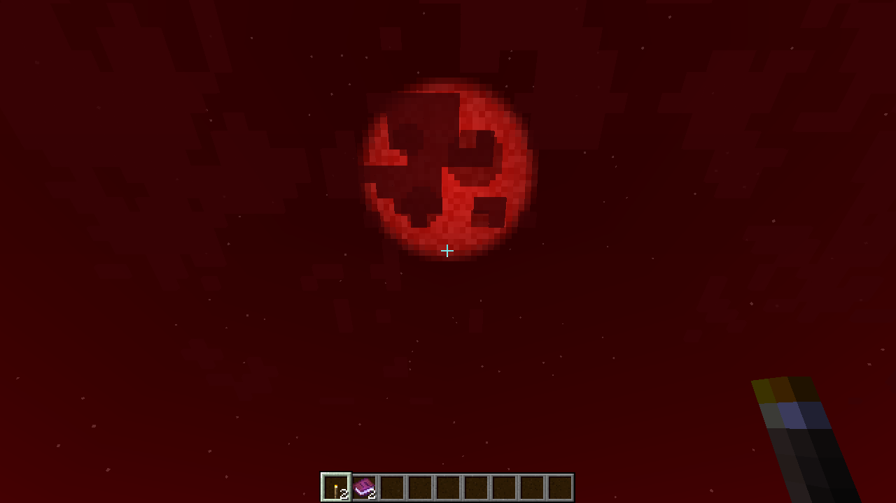

### Следы

Там, где никто не смотрит, он оставляет следы:
- **царапины** от трёх длинных пальцев на стенах (стадия 1+);
- **дорожку отпечатков рук** на полу, которая выходит из темноты и обрывается в паре шагов от тебя (стадия 2+);
- **надписи кровью** на стенах (стадия 2+, и всегда после резни в деревне). Их пишет что-то, что видело буквы, но никогда не писало: строчки скачут, буквы разного размера, некоторые перевёрнуты, с каждой стекает кровь. Например: «у тебя слишком мало пальцев», «я примерял твой голос», «не моргай. я моргну за тебя», «кожа это дверь», «ЗАЖГИ ЕЩЁ. МНЕ НРАВИТСЯ КАК ОНИ ГАСНУТ». Всего 16 фраз, на русском и английском.

Следы можно стереть: они ломаются с одного удара и ничего не оставляют. Их можно отключить вместе с остальными изменениями мира в конфиге.

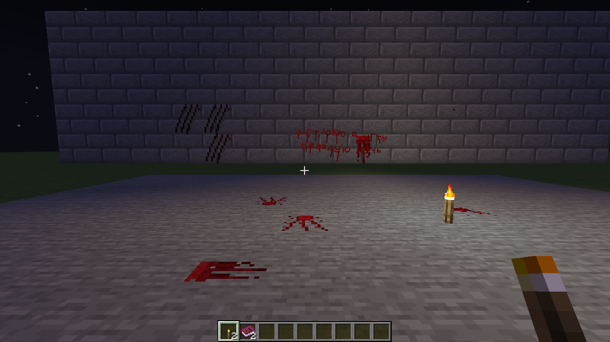

### Он грызёт стены

Со второй стадии из стены в паре блоков от тебя, чуть сбоку, может донестись скрежет и глухие удары. По блоку прямо на глазах ползут трещины, всё глубже, как будто его выгрызают с той стороны. Потом всё стихает. Блок цел, на нём свежие царапины, а трещины не сходят ещё минуту.

Бывает и так: просыпаешься утром, а по стене над изголовьем расходятся трещины, и рядом царапины. Всю ночь кто-то скрёбся там, у тебя над головой.

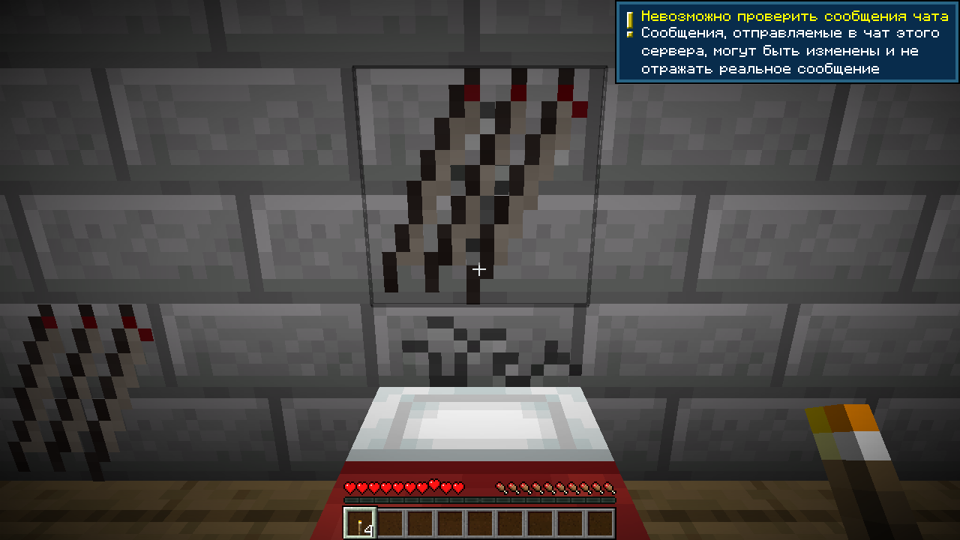

### Шаги на шаг позже

После шагов за спиной оно иногда идёт следом. Пока ты идёшь, за тобой повторяется каждый твой шаг, на долю секунды позже. Остановишься, и оно делает ещё один шаг. Повернёшься туда, откуда слышно, и шаги смолкают.

### Пока тебя нет дома

Со второй стадии, пока ты далеко от кровати (от 48 до 160 блоков), оно может зайти к тебе домой. Ничто тебя не предупредит, узнаешь, когда вернёшься. Сердце застучит, как только подойдёшь к кровати:
- двери, которые ты закрывал, открыты;
- факелы сняты со стен и стоят потухшими в ряд у изножья кровати;
- на подушке лежит одна вещь из твоего сундука, чаще всего меч, инструмент или броня;
- над изголовьем царапины от когтей;
- на полу отпечатки рук от двери до кровати.

Заходит не чаще раза в три дня, а если всегда спишь в одной кровати, чаще (см. «Он учится на тебе»). Пока дома кто-то есть, не заходит. Отключается вместе с остальными изменениями мира.

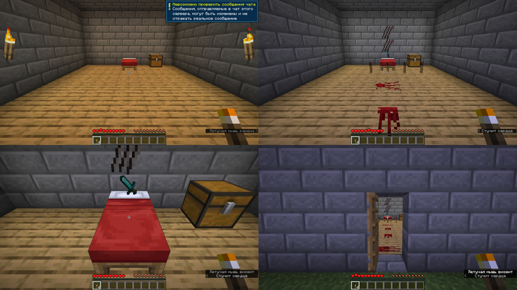

### Он учится на тебе

Что бы тебя ни спасало, он это запоминает и перестаёт тебе это позволять. Привычки копятся медленно, у каждого игрока свои, и сохраняются даже после смерти. Каждую ночь они понемногу выветриваются: что перестал делать, он со временем забывает.

| Привычка | Как он её замечает | Что меняется |
|---|---|---|
| **Прячешься на свету** | ты стоишь на свету, пока он рядом; ставишь много ярких источников | гасит свет чаще и с большего расстояния, события «свет гаснет» случаются чаще |
| **Забираешься повыше** | ты наверху, а он стоит внизу и смотрит | ждёт внизу дольше (до двух раз) и в следующий раз сразу появляется у подножия |
| **Спишь в одной кровати** | ты просыпаешься в той же кровати | чаще ходит к тебе домой, чаще бывает сонный паралич и трещины у изголовья |
| **Высматриваешь его** | ты ловишь его взглядом, и ему приходится перебегать | держится дальше за краем зрения, ближе к спине |

Когда привычка становится сильной, с наступлением ночи об этом сообщают: «Оно запомнило твой свет. Ждать, пока он погаснет, оно больше не будет.», «Оно знает, где ты спишь.», «Оно знает, что ты высматриваешь его. Теперь оно держится за спиной.»

### Лагерь прошлой жертвы

Иногда на ровном открытом месте попадается чужая стоянка. Холодный костёр, вокруг факелы, сгоревшие до огарков. Бревно, на котором сидели, исцарапано когтями. Палатка наполовину сорвана, на подстилке под ней кровь, а от подстилки в темноту уходит дорожка отпечатков рук: кого-то тащили.

В сундуке их вещи: немного хлеба, потухшие факелы, огниво, в котором осталась пара искр, один-два обрывка тени и дневник. Три разных дневника по пять страниц, на русском и английском. Каждый обрывается на полуслове.

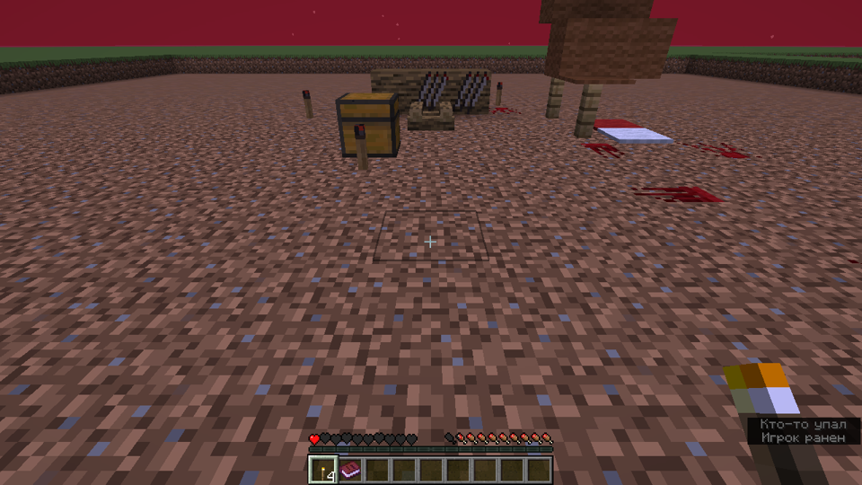

### Ловушки и приманки

**Колокольчик на нитке.** Повесь под блоком в проёме двери, в коридоре, у кровати. Когда оно проходит мимо, колокольчик звенит, даже если ты его не видишь. Звон слышно далеко, а у всех в 40 блоках сразу заходится сердце. Рецепт: нитка над золотым самородком, получается два.

**Кукла-приманка.** Проклятую куклу можно повесить в рамку где-нибудь в темноте. Пока она там висит, к ночи она не возвращается в карман. А когда оно придёт на охоту, то сначала пойдёт к кукле: присядет под ней и будет долго, секунд двенадцать, принюхиваться, дёргая головой. Слышно, как оно сопит. Как раз хватит времени, чтобы подойти с Фонарём откровения. Потом оно вскакивает, срывает куклу (кукла кричит) и идёт за тобой.

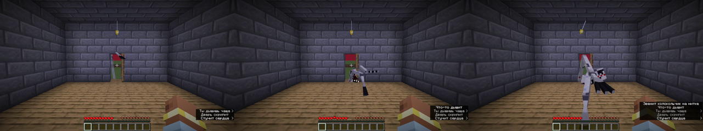

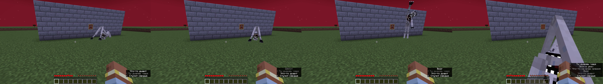

### Кооператив: оно утаскивает

Не уходите ночью поодиночке. Если игрок отошёл от всех дальше чем на 40 блоков и стоит в темноте, оно может его утащить. Крик обрывается, а друзьям в чат приходит: «Голос Игрок оборвался где-то в темноте.» Там, где он стоял, остаются кровь и дорожка отпечатков рук: его волокли по земле.

Утащенный оказывается в кошмаре: «Что-то держит тебя за ногу. Под тобой скребёт земля. Потом — ничего.» Он ищет кровать в темноте, как в обычном кошмаре. А друзья могут прийти на помощь: в конце дорожки из-под земли слышны приглушённые стоны и тяжёлое дыхание. Если осветить это место (поставить факел, бросить сигнальный огонь), оно отпускает, и игрок оказывается там, на земле: «Свет вернул Игрок.» Если не успеют, ему придётся выбираться самому. Ночь при этом не пропускается: друзья всё ещё в ней.

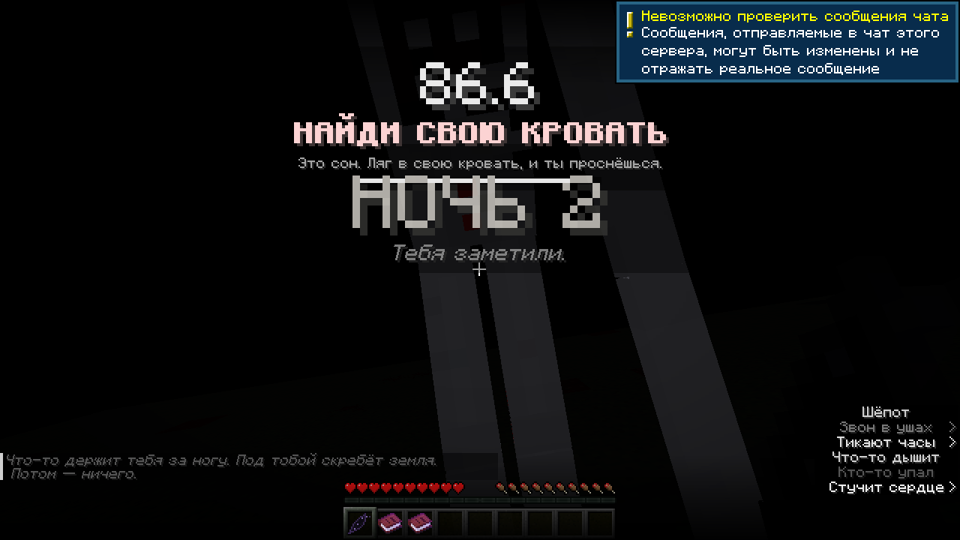

### Звуки

Его дыхание, хруст суставов, когда он ползёт, твоё сердцебиение и звук рвущейся плоти, когда он касается, сделаны из настоящих записей (свободная лицензия CC0). Авторы перечислены в [docs/CREDITS.md](docs/CREDITS.md), команды нарезки в `tools/import_sounds.sh`. Остальные звуки синтезированы `tools/gen_sounds.py`.

### Животные его чувствуют

Животные знают, где оно, раньше тебя, и это подсказка, куда смотреть:
- **собаки** перестают за тобой ходить, встают и рычат в пустой угол, а когда оно совсем близко, скулят и пятятся;
- **кошки** шипят и убегают;
- **лошади** встают на дыбы, даже под седлом;
- **коровы, овцы, свиньи, куры** замирают и смотрят на него, а если оно подходит ближе 9 блоков, убегают;
- **жители** оборачиваются к нему и качают головой.

Стены им не мешают, как и ему. С **второй стадии** бывает и так: все животные вокруг разом поворачиваются и десять секунд смотрят в одну и ту же пустую точку сбоку или за спиной, собаки рычат. Там никого нет. А потом все одновременно смотрят на тебя.

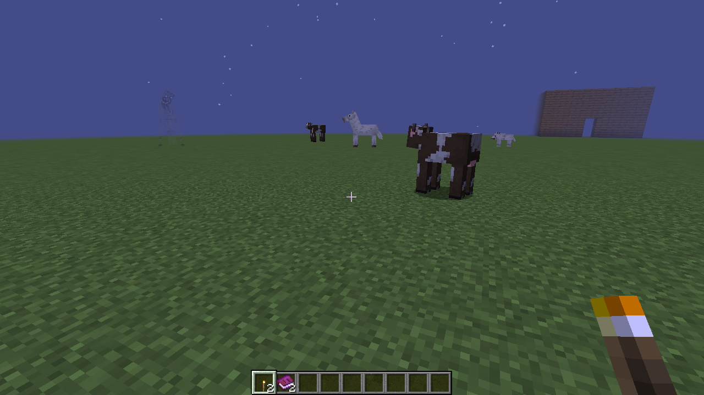

### Кошмары

Со второй стадии сон может обернуться кошмаром (30% ночей, на третьей стадии 45%). Ты просыпаешься в своей комнате, но это не она: копия всего вокруг кровати в месте, где всегда ночь. Весь свет погас, окна чёрные, сундуки пусты, на стенах кровь и надписи, а местами блоки стали не тем, чем были. Твоей кровати на месте нет.

На экране таймер: **НАЙДИ СВОЮ КРОВАТЬ**, полторы минуты. Кровать где-то поблизости, в слабом свете, единственном во всей темноте. Через 15 секунд в комнате появляется оно и кружит рядом, а через минуту начинает охоту.
- **Нашёл и лёг:** ты просыпаешься в настоящей кровати, за окном утро, в руке зажат обрывок тени.
- **Не успел, упал в пустоту или оно дотянулось:** просыпаешься с криком посреди ночи, с половиной здоровья.

**Сонный паралич.** Бывает, что ты проснулся, а пошевелиться не можешь. Ни повернуть голову, ни встать. Комната чуть завалена набок, веки тяжело опускаются и поднимаются. У изножья кровати стоит он. Медленно подходит ближе, хрипло дышит, шепчет. Глаза закрываются, а когда открываются, его нет. Это длится четыре с половиной секунды и ничем не грозит. Бывает со второй стадии и тем чаще, чем чаще ты спишь в одной и той же кровати.

Во сне нельзя умереть, потерять вещи, ломать и ставить блоки, а Фонарь откровения не загорается. Сигнальный огонь работает. Кошмары отключаются в конфиге (`nightmares`).

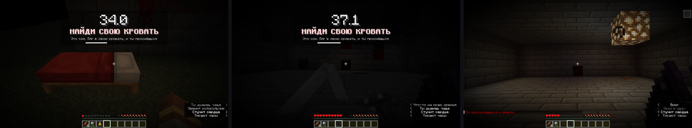

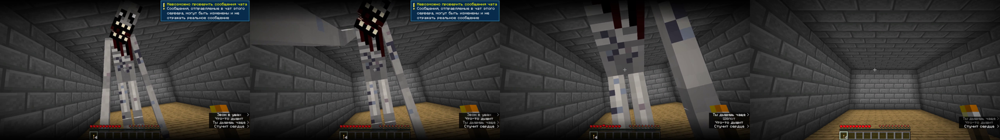

### Подражатель

Со второй стадии ночью вдалеке иногда стоит кто-то знакомый: с лицом и ником друга, который никак не может здесь быть (он далеко или в другом измерении). Если играешь один, то с твоим собственным лицом. Он машет и зовёт в чат от имени друга: «иди сюда. сюда. сюда.», «здесь безопасно». Если подойти ближе 6 блоков или слишком долго смотреть на него, раздаётся хруст: голова рывками проворачивается вверх ногами, и его больше нет. Вреда он не причиняет. Он здесь не для этого.

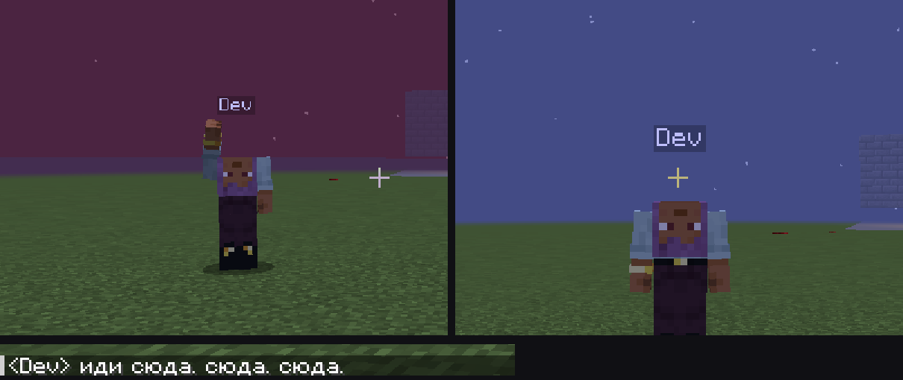

### Оно выходит за пределы мира

Игра запоминает худшую стадию, до которой оно доходило хоть в одном мире (файл `config/cornerofeye-memory.txt`), и меню начинают портиться, будто экран — это стекло:
- **с первой стадии** вместо жёлтой надписи-заставки висит тёмно-красная, и она не прыгает: «Оно помнит этот мир!», «Ты не выключил свет?», «Не загружай этот мир!». По главному меню идёт первая трещина;
- **со второй** края меню темнеют, трещин больше, и, пока сидишь в меню, новые медленно расползаются по экрану с тихим треском;
- **с третьей** по экрану расходится «паутина», как от удара, а кнопки иногда на мгновение говорят не то: «Оно ждёт», «Не уходи», «Позади тебя». Нажимаются они при этом как обычно.

Трещины в главном меню каждый раз одни и те же: экран треснул и так и остался.

В мире, начиная со второй стадии:
- **меню паузы** тоже в трещинах, и пока игра стоит на паузе, может треснуть ещё;
- **панель инвентаря** растрескалась (трещины под предметами, по самой панели), на третьей стадии новые трещины появляются прямо при открытии;
- **подсказки предметов шепчут:** у факела «их меньше, чем вчера», у фонаря «посвети мне в лицо», у чего угодно «оно трогало это ночью».

После изгнания память стирается и меню снова целое. Всё это отключается в клиентском конфиге (`menuCorruption`).

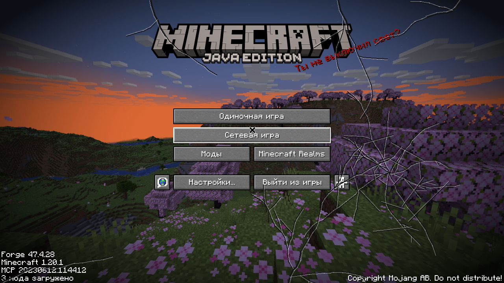

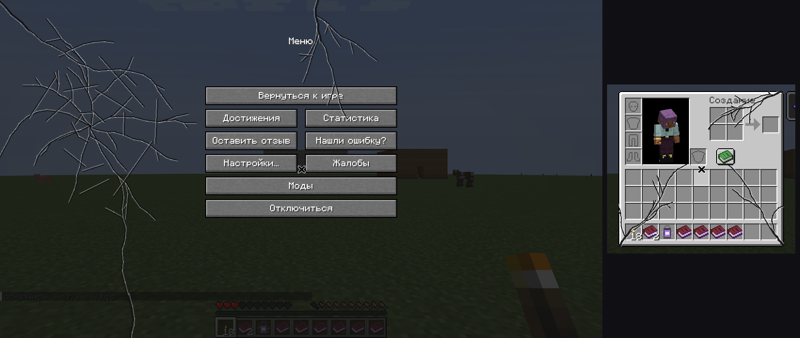

### Его моменты

Иногда вместо того, чтобы просто наблюдать, оно устраивает сцену. В эти секунды правило «только краем глаза» не действует: оно показывается само, и его видно любой частью экрана. Часто на экране загорается таймер с задачей. Если не справиться, оно касается (на стадии 2 ранит, на стадии 3 может убить). Если справиться, оно уходит и оставляет обрывок тени.

Чем дальше, тем чаще. По умолчанию моменты случаются примерно раз в 25 минут игры на стадии 1, раз в 15 минут на стадии 2 и раз в 8 минут на стадии 3. Частота настраивается.

| Момент | Что происходит | Задача |
|---|---|---|
| **Оно в доме** (стадия 2+) | Дверь рядом медленно со скрипом открывается. Оно вползает на четвереньках, внутри распрямляется во весь рост и идёт на тебя с вытянутыми руками | **ВСТАНЬ НА СВЕТ**. Если ты уже на свету, оно гасит свет вокруг, и задача становится **ЗАЖГИ СВЕТ** |
| **Из-за дерева** (стадия 1+) | Медленно высовывается из-за ствола: голова завалена набок, пальцы вцепились в кору. Если встретиться с ним взглядом (около 0,6 секунды), резко прячется. Если подойти, оставит обрывок | Нет, это просто жуть |
| **Из потолка** (пещеры, стадия 1+) | Из каменного свода над тобой медленно свешивается он, вниз головой, с болтающимися руками, голова ищет тебя. Если встретиться с ним взглядом, втягивается обратно | Нет, просто жуть |
| **Лицо в окне** (стадия 2+, в доме) | За стеклом окна, в нескольких блоках от тебя, в темноте появляется он: сидит снаружи на корточках, ладони прижаты к стеклу, лицо почти касается его. Время от времени медленно ведёт когтями по стеклу со скрипом. Если отвернёшься, стучит по стеклу три раза. Если посмотреть прямо на него или подойти к окну, отдёргивается и пропадает, а на стекле остаются отпечатки ладоней | Нет, просто жуть |
| **Не оборачивайся** (стадия 2+) | Дыхание и шёпот прямо в затылок. Оно нависает сзади и следует за тобой | **НЕ ОБОРАЧИВАЙСЯ**: если увидишь его, всё |
| **Темнота** (стадия 2+) | Весь свет вокруг гаснет один за другим, даже тот, на который смотришь. Оно выходит из темноты прямо на тебя | **ЗАЖГИ СВЕТ**, пока оно не дошло. Бывает только если у тебя есть чем светить |
| **Не двигайся** (стадия 2+) | Оно ползает кругами вокруг тебя, принюхивается, каждый круг всё ближе | **НЕ ДВИГАЙСЯ**: присядь и замри до конца таймера |
| **Под водой** (стадия 2+) | Пока ты плаваешь, из тёмной глубины под тобой поднимается он с поднятыми руками | **ВЫБЕРИСЬ ИЗ ВОДЫ**: на берег или в лодку. Провал: он утаскивает вниз |
| **Резня в деревне** (стадия 2+, редко) | Ночью в деревне гаснет свет, а жители пропадают по одному, только когда на них никто не смотрит. В темноте слышны крики. Остаются трупы и кровь, дети исчезают бесследно, железные големы тоже не спасут. Спящих он убивает прямо в кроватях: тело остаётся лежать, простыни красные, кровать при этом не «занята». Потом он идёт за тобой | После резни начинается **погоня** |
| **Погоня** (стадия 3, и после резни) | Он вылетает из темноты на четвереньках прямо на тебя, всё быстрее | **ВСТАНЬ НА СВЕТ** (или **ЗАЖГИ СВЕТ**, если он погасил твой) |

Таймер тикает, в последние 3 секунды тикает вдвое чаще и мигает красным. Если поймать его вспышкой Фонаря откровения прямо посреди момента, это тоже считается спасением (и ранением для него). Резня случается не чаще раза в 3 дня, и её можно отключить в конфиге: она убивает жителей по-настоящему.


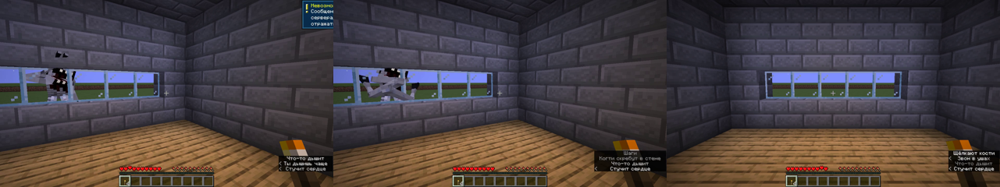


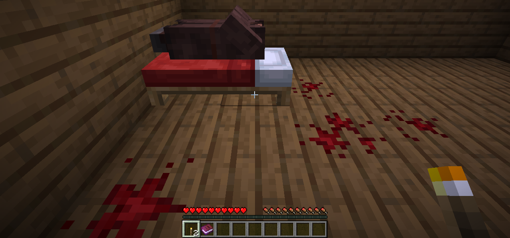

### Как его одолеть

1. **Обрывки тени.** Когда он наблюдает издалека, иди к тому месту, где его видел. Близко он не подпустит и исчезнет, но оставит обрывок тени. На стадиях 1–2 обрывок остаётся всегда, на третьей только в 30% случаев.
2. **Фонарь откровения.** Рецепт открывается с первым обрывком:
   ```
   А О А
   О Ф О      А — осколок аметиста, О — обрывок тени, Ф — фонарь
   А О А
   ```
3. **Вспышка.** Зажми ПКМ на 1,5 секунды и отпусти. Если в момент вспышки он хоть где-то в поле зрения, даже в самом углу, он пойман: застывает видимым и кричит. Каждая вспышка сжигает 1 обрывок. Перезарядка 10 секунд. Радиус 20 блоков, на третьей стадии только 12.
4. **Три поимки, и он уходит навсегда.** Но последняя засчитывается только в последнюю ночь (см. ниже). Вся команда получает испытание «Углы опустели».

### Последняя ночь

Когда остаётся одна поимка, следующая ночь становится последней: всегда кровавая луна, на экране «НОЧЬ N / Последняя ночь.». В сумерках весь свет вокруг каждого игрока гаснет волной, и через несколько секунд оно уже идёт за кем-то из вас. Оно приходит не одно: вместе с ним две пустые копии. Вспышка по копии сжигает обрывок впустую («Пусто. Там ничего не было.»). Отличить настоящее можно по животным: собаки рычат только на него. В любую другую ночь последняя поимка не засчитывается: «Оно смеётся».

Если поймать настоящее, оно раскидывает руки и трескается, бьёт молния без огня, всех рядом ослепляет вспышка. Всё, что оно когда-либо погасило, снова светит, встаёт солнце, и на экране появляется «УГЛЫ ОПУСТЕЛИ / Оно ушло. Навсегда.».

**После.** Изредка ночью остаётся эхо: шаги, шёпот, животные, на миг уставившиеся в пустоту. Вреда от него нет. Если в конфиге задано `returnAfterDays`, через столько дней оно возвращается, и всё начинается заново с первой стадии: «Углы снова не пусты.» По умолчанию оно не возвращается.

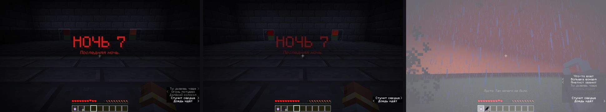

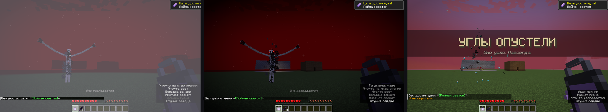

**Игрок узнаёт это постепенно.** Записки прежнего жильца приходят главами, по одной, «между вещей»:

| Глава | Когда приходит | О чём |
|---|---|---|
| 1 | начало стадии 1 | как оно себя ведёт и что гасит свет |
| 2 | первый подобранный обрывок (или через день) | откуда берутся обрывки, собирать до охоты, животные чувствуют, где оно |
| 3 | 2 обрывка в инвентаре (или стадия 2) | рецепт Фонаря откровения |
| 4 | скрафчен фонарь (или день после стадии 2) | как работает вспышка |
| 5 | стадия 2 | моменты с таймером, огниво, свежий яркий свет |
| 6 | первая поимка (или стадия 3) | «три раза — и оно уйдёт навсегда» |
| 7 | стадия 3 | седьмая ночь |

Главы идут строго по порядку, не чаще раза в 30 секунд. Вкладка достижений «Краем глаза» ведёт по тому же пути.


## Предметы

| Предмет | Рецепт | Что делает |
|---|---|---|
| **Колокольчик-оберег** | нитка над золотым слитком, железные самородки по бокам и снизу | На панели быстрого доступа или во второй руке звенит, когда оно ближе 24 блоков, и чем ближе, тем чаще. Звон слышат все рядом. На третьей стадии ночью он иногда звенит, когда рядом никого нет. Наверное |
| **Зеркальце** | стекло в железных самородках на палке | Зажми ПКМ: зеркало показывает, что за спиной. Это единственный способ посмотреть на него прямо, но только через плечо. Каждый раз, когда оно появляется в зеркале, стекло трескается; шесть трещин, и зеркало разбито |
| **Сигнальный огонь** | бумага, порох, редстоун, уголь | Бросается. Там, где упал, полминуты горит красным и светит на полную. Этот свет оно потушить не может: настоящий свежий свет посреди погони |
| **Колокольчик на нитке** | нитка над золотым самородком (2 шт.) | Вешается под блок. Звенит, когда оно проходит под ним или рядом. См. «Ловушки и приманки» |
| **Проклятая кукла** | нитка, шерсть и обрывок тени | Пока она у тебя, обрывков вдвое больше, но и оно приходит чаще: ты для него желаннее, моменты случаются чаще. Выбросишь, и через минуту она снова в кармане. Спрячешь в сундук, и к ночи она снова у тебя, а старая рассыпается. Избавиться можно только огнём или лавой. Если повесить её в рамку в темноте, она станет приманкой (см. «Ловушки и приманки»). Ещё одну такую можно найти в деревне после резни, в пустой детской кровати |

Рецепты открываются в книге рецептов, когда в руках оказывается подходящий материал, а записки прежнего жильца рассказывают о каждом предмете.

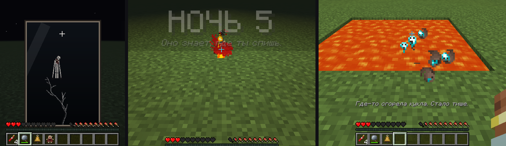

## Команды (уровень оператора 2)

| Команда | Что делает |
|---|---|
| `/cornerofeye status` | Стадия, день, ранения, рядом ли он |
| `/cornerofeye stage <0-3>` / `stage auto` | Зафиксировать стадию или вернуть отсчёт по дням |
| `/cornerofeye appear <watch\|stalk\|hunt> [игрок]` | Вызвать его прямо сейчас |
| `/cornerofeye moment <door\|peek\|behind\|lights_out\|still\|ceiling\|underwater\|massacre\|chase\|window\|paralysis\|lured> [игрок]` | Запустить момент прямо сейчас (если вокруг есть всё нужное: дверь, дерево, свет, потолок пещеры, глубокая вода, жители, окно, кровать, кукла в рамке) |
| `/cornerofeye event <событие> [игрок]` | `footsteps`, `mining`, `door`, `whisper`, `lights_out`, `far_light_out`, `fake_chat`, `sign`, `distant_sound`, `scratches`, `handprints`, `writing`, `stare`, `mimic`, `gnaw` |
| `/cornerofeye dream [игрок]` | Отправить в кошмар прямо сейчас |
| `/cornerofeye visit [игрок]` | Зайти к игроку домой прямо сейчас (рядом с кроватью никого не должно быть) |
| `/cornerofeye morning [игрок]` | Утренние трещины над изголовьем кровати |
| `/cornerofeye take <игрок>` | Утащить игрока в кошмар, как в коопе (без проверки, один ли он) |
| `/cornerofeye director [игрок] [next]` | Показать волну игрока (тишина, нарастание, ожидание, встреча) и его привычки; `next` переключает на следующую фазу |
| `/cornerofeye habit <игрок> <light\|height\|bed\|gaze> <0-1>` | Выставить силу привычки |
| `/cornerofeye wounds <число>` | Выставить число поимок (например, 2, чтобы сразу дойти до последней ночи) |
| `/cornerofeye bloodmoon on\|off` | Включить или выключить кровавую луну (если включить днём, она взойдёт этой ночью) |
| `/cornerofeye reset` | Начать всё заново с дня 0 (записки тоже) |

## Настройки

`config/cornerofeye-common.toml`:
- дни до каждой стадии;
- частота событий;
- уровень света, который его останавливает;
- урон касания;
- число поимок для изгнания;
- можно ли ему менять мир (свет, двери, таблички, следы и надписи);
- ломает ли он блоки, чтобы добраться до тебя, и выпадают ли они;
- фейковый чат;
- выдача записок;
- как часто случаются моменты на каждой стадии (в минутах);
- резня в деревне (вкл/выкл) и минимум дней между резнями;
- кошмары во сне (вкл/выкл);
- эхо после изгнания (вкл/выкл) и через сколько дней оно возвращается (0 = никогда).

`config/cornerofeye-client.toml`: скримеры, туман, эффекты экрана, приглушение звуков мира и порча меню. Можно отключить, например, для чувствительных зрителей.

**Для трейлеров и скриншотов:** клиент с JVM-флагом `-Dcornerofeye.alwaysVisible=true` рисует его всегда, а не только краем глаза. Поставить его в нужной позе можно так: `/summon cornerofeye:the_one ~ ~ ~ {NoAI:1b,Stage:3,Days:9,Crawling:1b}` (ещё есть `Phase`, `Scene` и `Anim`).

## Публикация

В `docs/publishing/` лежат рендеры монстра с прозрачным фоном (10 поз), иконка мода, промпты для генерации логотипа, баннера, иконки, постера и обложки видео, а также готовые описания мода на русском и английском.

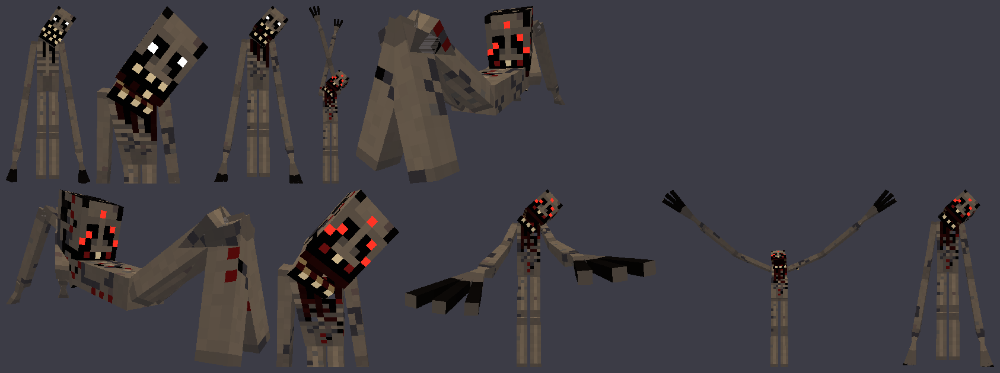

## Сборка

Нужен JDK 17.

```
./gradlew build          # jar в build/libs/
./gradlew runClient      # запустить игру с модом
```

Мод использует Mixin: погашенные блоки не дают света, замирающие печи, тёмный рендер погашенного. Всё это подключается автоматически при сборке.

Текстуры, звуки и переводы генерируются скриптами из `tools/`: `gen_textures.py` (Pillow), `gen_sounds.py` (numpy + ffmpeg) и `gen_lang.py`. Рендеры модели для публикаций снимаются на зелёном фоне и вырезаются `chroma_key.py`. Чтобы поменять текст или внешний вид, правь скрипт и перезапусти его.
