# Краем глаза / Corner of the Eye

Хоррор-мод для **Minecraft 1.20.1 (Forge 47.x)**, для одиночной игры и кооператива.

В мире живёт **Тот, что в углу**. Он виден только краем глаза: стоит посмотреть прямо, и его нет. Он гасит свет, на который ты не смотришь, проходит сквозь стены и с каждой ночью подбирается ближе. Его нужно изгнать до седьмой ночи, потом будет намного сложнее.

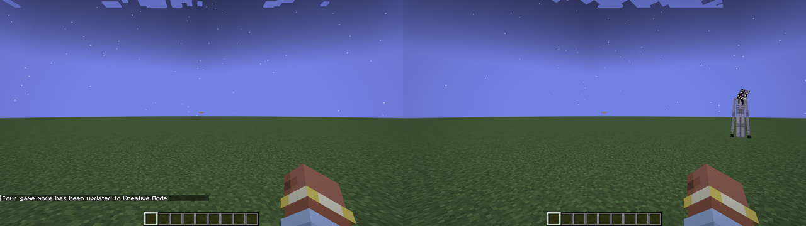

## Как это работает

**Его видно только краем глаза.** Каждый клиент считает, где на экране находится монстр, и плавно растворяет его ближе к центру. В коопе один игрок может его видеть, а другой нет. Если долго смотреть прямо на него, он перескакивает в другое место, чуть ближе.

**Свет — единственная защита.** В освещённые блоки он не заходит и не может тронуть игрока, который стоит на свету. Поэтому он гасит свет, причём только тот, на который сейчас никто не смотрит. Подробнее в разделе «Свет и факелы».

**Стены не спасают.** Он проходит сквозь блоки.

**Убивает не сразу.** На второй стадии касание ранит, но никогда не убивает. На третьей касание отнимает половину здоровья, после чего монстр отходит и снова наблюдает. Если остаться в темноте, второе касание убьёт.

**Монстр один на весь мир.** Каждую ночь он выбирает одну жертву, чаще того, кто один и в темноте. Разделяться опасно.

**Страх без шкалы.** На экране нет никаких полосок. О том, насколько близко опасность, говорят только чувства:
- **Сердцебиение.** Чем он ближе, тем чаще и громче стучит сердце. На поздних стадиях оно ускоряется уже просто в темноте.
- **Удар «краем глаза».** Когда он появляется на краю экрана, звучит резкий диссонансный аккорд. Даже если ты его не заметил, уши заметили.
- **Твоё дыхание.** При сильном страхе слышно собственное частое дыхание, а когда он совсем рядом, звенит в ушах.
- **Мир затихает.** Звуки мира (шаги, блоки, погода, животные) становятся тише и чуть ниже, будто время замедлилось. Громким остаётся только он и твоё сердце. Под всем этим нарастает низкий гул.
- **Зрение сужается.** Края экрана темнеют и пульсируют в такт сердцу, угол обзора слегка сужается, а значит, места, чтобы заметить его краем глаза, становится меньше. При сильном страхе дрожит камера.
- **Резкие всплески.** Когда рядом гаснет свет, сердце подпрыгивает.

**С каждым днём он страшнее.** Он подрастает каждый день. На второй стадии по коже ползут чёрные вены, у рта засохшая кровь. На третьей кожа трескается, проступают рёбра, появляются лишние глаза, и все горят красным, когти длиннее, челюсть отвисает сильнее, он чаще дёргается, голос ниже, а скример становится другим.

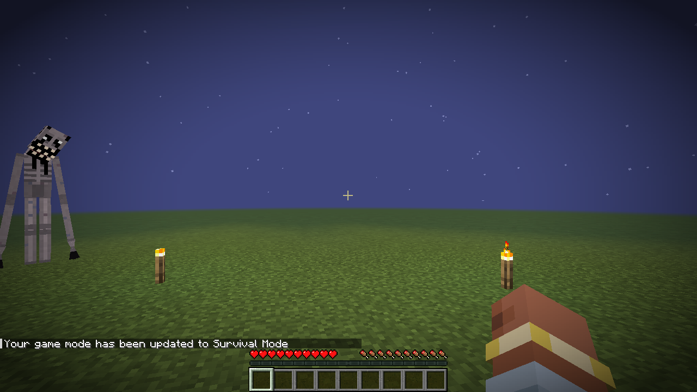

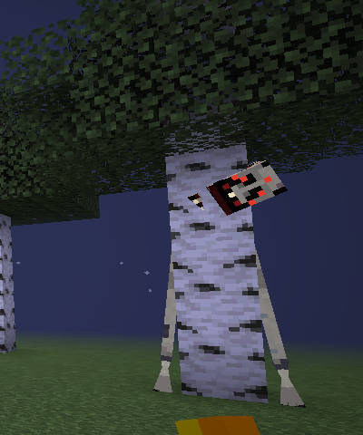

## Свет и факелы

- **Пока он охотится или устраивает момент, гаснет любой свет:** факелы, фонари, костры, свечи, лампы, светокамень, морские фонари, грибосвет, свет из других модов. Погашенные блоки выглядят мёртвыми и не дают ни капли света.
- **Печи** (обычная, коптильня, плавильная) гаснут и замирают: огонь пропадает вместе с топливом, которое горело, переплавка стоит.
- **Само ничего не загорается.** Даже после того как он ушёл, всё погашенное остаётся погасшим.
- **Разжечь можно огнивом или огненным зарядом:** правый клик по погасшему блоку. Печь после этого снова берёт топливо и продолжает работу.
- **Пока он рядом, огниво не помогает:** «Не загорается. Пока оно здесь — нет.» Спасает только свежий свет, например новый факел из инвентаря.
- **Важна яркость.** Под таймером видно «СВЕТ 6 / 9»: нужно стоять достаточно близко к источнику. Одной печки в углу комнаты мало.
- **Погашенный им блок мёртв:** если его сломать, он рассыпается без дропа. Содержимое печки при этом выпадает. Так что «сломать и поставить заново» не сработает.
- **Факелы сгорают** в «потухший факел». Если сломать и поставить обратно, он так и останется потухшим, разжигается только огнивом.
- **Факелы теперь дорогие:** уголь + нить + палка (сверху вниз) = 1 факел. Факел душ делается так же, плюс песок или почва душ.

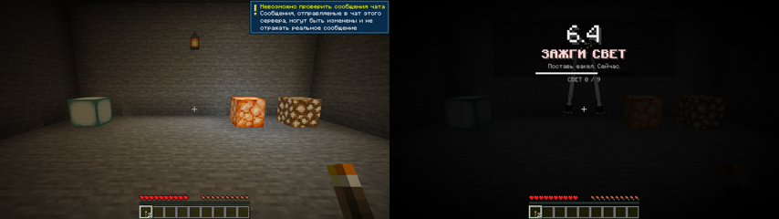

### Стадии

Счёт идёт по времени, проведённому в мире (20 минут = 1 день). Сон и `/time set` его не сбивают.

| День | Стадия | Что происходит |
|---|---|---|
| 0–1 | Тишина | Далёкие звуки; иногда гаснет свет на краю базы |
| 2–3 | Наблюдение | Ночью и в тёмных пещерах стоит вдали и смотрит. Шаги за спиной, стук в дверь, копание в стенах. В кармане появляются чужие записки |
| 4–5 | Приближение | Подходит ближе, кружит по краю зрения, гасит свет вокруг. Шёпот, фейковый чат (в коопе от имени друга), таблички, прерывает сон. Может ранить |
| 6+ | Охота | Каждую ночь, сквозь стены, касание может убить. Густой туман |

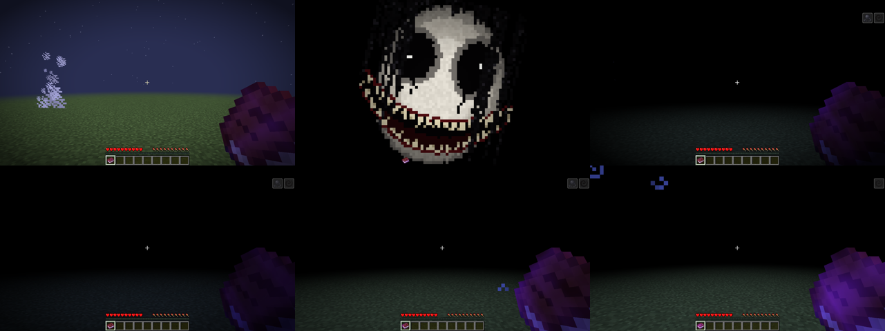

### Его моменты

Иногда вместо того, чтобы просто наблюдать, оно устраивает сцену. В эти секунды правило «только краем глаза» не действует: оно показывается само, и его видно любой частью экрана. Часто на экране загорается таймер с задачей. Если не справиться, оно касается (на стадии 2 ранит, на стадии 3 может убить). Если справиться, оно уходит и оставляет обрывок тени.

Чем дальше, тем чаще. По умолчанию моменты случаются примерно раз в 25 минут игры на стадии 1, раз в 15 минут на стадии 2 и раз в 8 минут на стадии 3. Частота настраивается.

| Момент | Что происходит | Задача |
|---|---|---|
| **Оно в доме** (стадия 2+) | Дверь рядом медленно со скрипом открывается. Оно вползает на четвереньках, внутри распрямляется во весь рост и идёт на тебя с вытянутыми руками | **ВСТАНЬ НА СВЕТ**. Если ты уже на свету, оно гасит свет вокруг, и задача становится **ЗАЖГИ СВЕТ** |
| **Из-за дерева** (стадия 1+) | Медленно высовывается из-за ствола: голова завалена набок, пальцы вцепились в кору. Если встретиться с ним взглядом (около 0,6 секунды), резко прячется. Если подойти, оставит обрывок | Нет, это просто жуть |
| **Из потолка** (пещеры, стадия 1+) | Из каменного свода над тобой медленно свешивается он, вниз головой, с болтающимися руками, голова ищет тебя. Если встретиться с ним взглядом, втягивается обратно | Нет, просто жуть |
| **Не оборачивайся** (стадия 2+) | Дыхание и шёпот прямо в затылок. Оно нависает сзади и следует за тобой | **НЕ ОБОРАЧИВАЙСЯ**: если увидишь его, всё |
| **Темнота** (стадия 2+) | Весь свет вокруг гаснет один за другим, даже тот, на который смотришь. Оно выходит из темноты прямо на тебя | **ЗАЖГИ СВЕТ**, пока оно не дошло. Бывает только если у тебя есть чем светить |
| **Не двигайся** (стадия 2+) | Оно ползает кругами вокруг тебя, принюхивается, каждый круг всё ближе | **НЕ ДВИГАЙСЯ**: присядь и замри до конца таймера |
| **Под водой** (стадия 2+) | Пока ты плаваешь, из тёмной глубины под тобой поднимается он с поднятыми руками | **ВЫБЕРИСЬ ИЗ ВОДЫ**: на берег или в лодку. Провал: он утаскивает вниз |
| **Резня в деревне** (стадия 2+, редко) | Ночью в деревне гаснет свет, а жители пропадают по одному, только когда на них никто не смотрит. В темноте слышны крики. Остаются трупы и кровь, дети исчезают бесследно, железные големы тоже не спасут. Потом он идёт за тобой | После резни начинается **погоня** |
| **Погоня** (стадия 3, и после резни) | Он вылетает из темноты на четвереньках прямо на тебя, всё быстрее | **ВСТАНЬ НА СВЕТ** (или **ЗАЖГИ СВЕТ**, если он погасил твой) |

Таймер тикает, в последние 3 секунды тикает вдвое чаще и мигает красным. Если поймать его вспышкой Фонаря откровения прямо посреди момента, это тоже считается спасением (и ранением для него). Резня случается не чаще раза в 3 дня, и её можно отключить в конфиге: она убивает жителей по-настоящему.

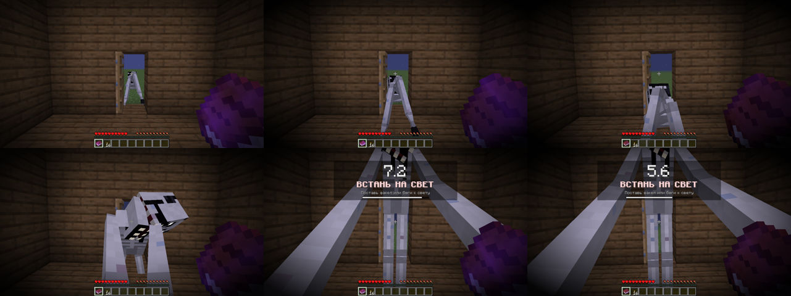

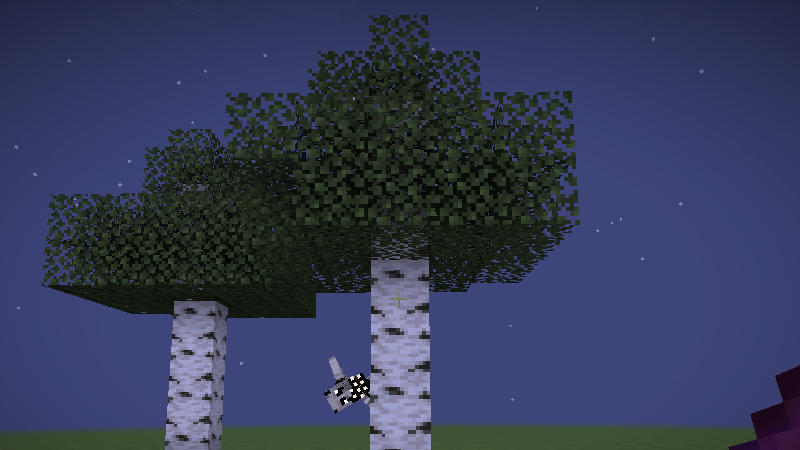

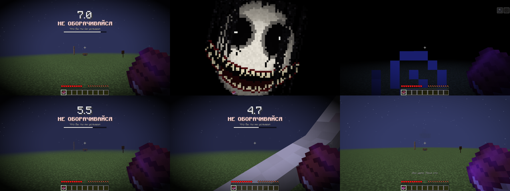

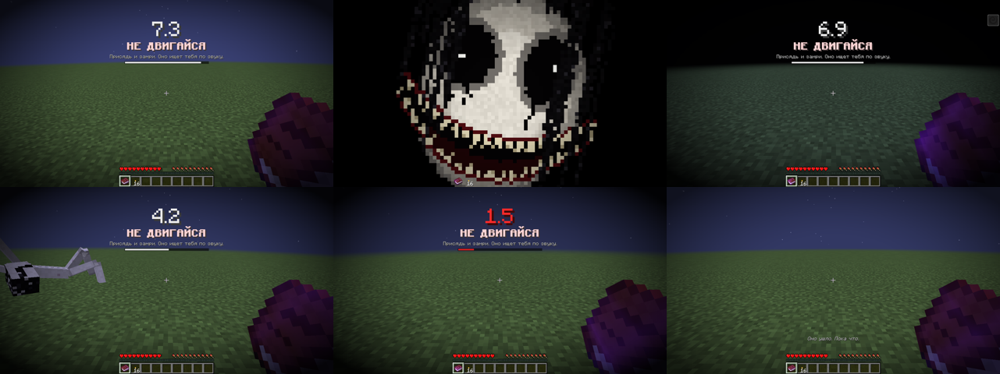

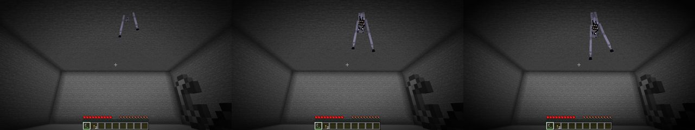

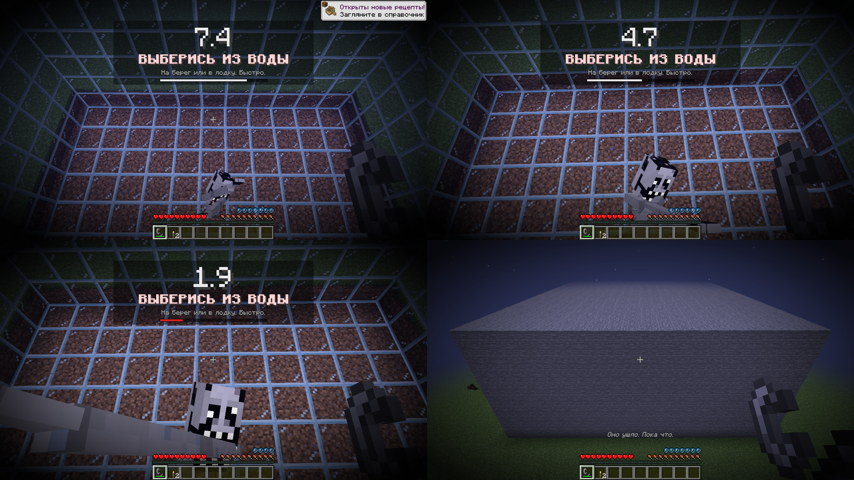

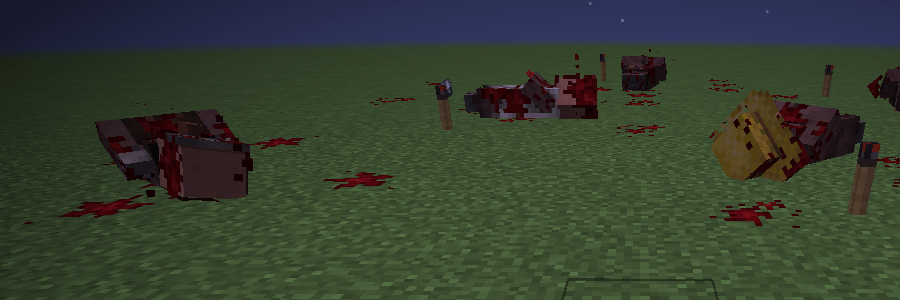

### Как его одолеть

1. **Обрывки тени.** Когда он наблюдает издалека, иди к тому месту, где его видел. Близко он не подпустит и исчезнет, но оставит обрывок тени. На стадиях 1–2 обрывок остаётся всегда, на третьей только в 30% случаев.
2. **Фонарь откровения.** Рецепт открывается с первым обрывком:
   ```
   А О А
   О Ф О      А — осколок аметиста, О — обрывок тени, Ф — фонарь
   А О А
   ```
3. **Вспышка.** Зажми ПКМ на 1,5 секунды и отпусти. Если в момент вспышки он хоть где-то в поле зрения, даже в самом углу, он пойман: застывает видимым и кричит. Каждая вспышка сжигает 1 обрывок. Перезарядка 10 секунд. Радиус 20 блоков, на третьей стадии только 12.
4. **Три поимки, и он уходит навсегда.** Вся команда получает испытание «Углы опустели».

**Игрок узнаёт это постепенно.** Записки прежнего жильца приходят главами, по одной, «между вещей»:

| Глава | Когда приходит | О чём |
|---|---|---|
| 1 | начало стадии 1 | как оно себя ведёт и что гасит свет |
| 2 | первый подобранный обрывок (или через день) | откуда берутся обрывки, собирать до охоты |
| 3 | 2 обрывка в инвентаре (или стадия 2) | рецепт Фонаря откровения |
| 4 | скрафчен фонарь (или день после стадии 2) | как работает вспышка |
| 5 | стадия 2 | моменты с таймером, огниво, свежий яркий свет |
| 6 | первая поимка (или стадия 3) | «три раза — и оно уйдёт навсегда» |
| 7 | стадия 3 | седьмая ночь |

Главы идут строго по порядку, не чаще раза в 30 секунд. Вкладка достижений «Краем глаза» ведёт по тому же пути.

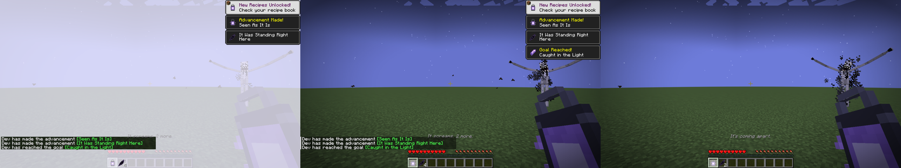

## Команды (уровень оператора 2)

| Команда | Что делает |
|---|---|
| `/cornerofeye status` | Стадия, день, ранения, рядом ли он |
| `/cornerofeye stage <0-3>` / `stage auto` | Зафиксировать стадию или вернуть отсчёт по дням |
| `/cornerofeye appear <watch\|stalk\|hunt> [игрок]` | Вызвать его прямо сейчас |
| `/cornerofeye moment <door\|peek\|behind\|lights_out\|still\|ceiling\|underwater\|massacre\|chase> [игрок]` | Запустить момент прямо сейчас (если вокруг есть всё нужное: дверь, дерево, свет, потолок пещеры, глубокая вода, жители) |
| `/cornerofeye event <событие> [игрок]` | `footsteps`, `mining`, `door`, `whisper`, `lights_out`, `far_light_out`, `fake_chat`, `sign`, `distant_sound` |
| `/cornerofeye reset` | Начать всё заново с дня 0 (записки тоже) |

## Настройки

`config/cornerofeye-common.toml`:
- дни до каждой стадии;
- частота событий;
- уровень света, который его останавливает;
- урон касания;
- число поимок для изгнания;
- можно ли ему менять мир (свет, двери, таблички);
- фейковый чат;
- выдача записок;
- как часто случаются моменты на каждой стадии (в минутах);
- резня в деревне (вкл/выкл) и минимум дней между резнями.

`config/cornerofeye-client.toml`: скримеры, туман, эффекты экрана и приглушение звуков мира. Можно отключить, например, для чувствительных зрителей.

## Сборка

Нужен JDK 17.

```
./gradlew build          # jar в build/libs/
./gradlew runClient      # запустить игру с модом
```

Мод использует Mixin: погашенные блоки не дают света, замирающие печи, тёмный рендер погашенного. Всё это подключается автоматически при сборке.

Текстуры, звуки и переводы генерируются скриптами из `tools/`: `gen_textures.py` (Pillow), `gen_sounds.py` (numpy + ffmpeg) и `gen_lang.py`. Чтобы поменять текст или внешний вид, правь скрипт и перезапусти его.
